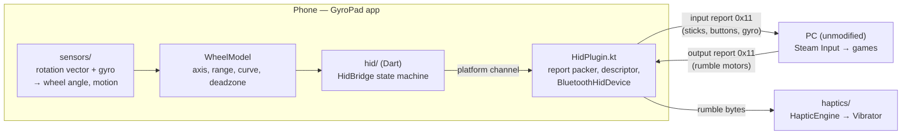
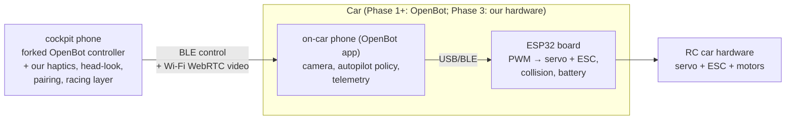

# Architecture

How the system fits together, and the constraints code must respect. This document is the bridge between the decisions ([DECISIONS.md](DECISIONS.md)) and the code: it names the modules, their responsibilities, the contracts between them, and the invariants that must not break.

Read order for implementers: [DECISIONS.md](DECISIONS.md) for why, this file for what and how, [docs/ROADMAP.md](ROADMAP.md) for when, [docs/specs/](specs/README.md) for per-milestone detail. Facts and measurements live in [RESEARCH.md](RESEARCH.md).

## Bird's-eye view

**Tier 1 (Phase 0):** the phone is a DS4 controller; the PC is unmodified.



**Tiers 2–3 (Phase 1+):** the OpenBot pattern — one phone rides the car as camera and brain; the cockpit phone runs our forked controller.



## Tier 1 — the GyroPad app

### Components

| Module | Layer | Responsibility | Key files (planned) |
|--------|-------|----------------|---------------------|
| `sensors/` | Dart | Listen rotation vector + gyroscope; produce the wheel angle and the 6-axis motion triple at sensor rate | `SensorFusionService`, `WheelModel` |
| `hid/` (Dart) | Dart | Platform-channel bridge and connection state machine: unpaired → registered → connected → streaming → error | `HidBridge` |
| `hid/` (native) | Kotlin | DS4 emulation: SDP app record, HID report descriptor, input-report packing, output-report reception over `BluetoothHidDevice` (API 28+) | `HidPlugin.kt` |
| `haptics/` | Dart | Map rumble bytes (and later car telemetry) to `VibrationEffect` waveforms; rate-limit; degrade gracefully without amplitude control | `HapticEngine` |
| `layouts/` | Flutter UI | Wheel, gamepad, settings, connection screens; zero-latency local rendering of input state | per-screen files |

### The DS4 emulation contract

The emulated controller must behave like a real DualShock 4 or Steam and games will misread it. The binding rules:

- **Input report `0x11`** (the 78-byte full report) carries: left/right stick bytes (unsigned, centered at 128), button/trigger bit fields, the 6-axis motion block (accelerometer XYZ, gyroscope XYZ — signed 16-bit little-endian), a timestamp, and the battery nibble. The report descriptor declaring this map is the community-documented DS4 descriptor; the full byte layout is specified in the M1 spec (`docs/specs/`) and in code comments, not duplicated here.
- **Report-mode behavior:** a real DS4 sends the small input report `0x01` (10 bytes, standard gamepad usages) until the host reads feature `0x02` (calibration), then switches to `0x11`. The app replicates this exactly: `0x01` feeds Windows' in-box HID stack (which parses only the standard usages), the `0x11` switch feeds a Steam DS4 path.
- **Output report `0x11`** (78 bytes over Bluetooth) carries the two rumble motor intensities set by the game. `0x05` is the USB descriptor's output report — it does not exist on the Bluetooth path. `HidPlugin.kt` receives output reports via the `onInterruptData` callback (interrupt channel) or `onSetReport` (control channel) and forwards them to the `HapticEngine`.
- **Host identity limit:** the phone advertises its own USB VID/PID in the SDP Device-ID record (apps cannot set Sony's `054C:05C4`). Windows is unaffected; whether Steam classifies the device as a DS4 is measured in M1 and recorded in the spec's open questions — if it does not, M2's gyro path needs a user decision (see [RESEARCH.md](RESEARCH.md)).
- **Motion block semantics:** gyro values are angular rates; the app integrates them (with the fused rotation vector as drift correction) into the wheel angle. Sticks and buttons map 1:1 from `WheelModel` and layout state.
- **Battery nibble** reports the phone's battery — Steam then shows something truthful.
- **Report rate:** send at the sensor rate, capped at ~120 Hz as the starting target; adjust after M1 measures real behavior. Never batch or skip frames to save work — stale motion reads as lag.
- **Byte-faithfulness rule:** any change to the descriptor or report packing requires a device test on the user's PC before merge (CONVENTIONS.md).

### Data flows

1. **Input path (hot loop):** sensor event → `SensorFusionService` → `WheelModel` (clamp to ±range/2, deadzone, response curve) → `HidBridge` → `HidPlugin.packReport` → `sendReport`. Budget: end-to-end under ~10 ms on the phone; no allocations in the hot loop; vibration never runs on this path's thread.
2. **Haptic path (cold loop):** `onOutputReport` → parse motor bytes → `HapticEngine` → `Vibrator` waveform. Rate-limited; drops gracefully on devices without amplitude control.
3. **Pairing lifecycle:** app registers as HID device on launch → user pairs from the PC's Bluetooth settings (app guides with on-screen steps) → state machine tracks the connection and surfaces it in the UI (see [UIUX.md](UIUX.md) constraints). Re-zeroing the wheel is a user action, always available.

### Performance budget

| Quantity | Budget | Why |
|----------|--------|-----|
| Input path (sensor → report sent) | < 10 ms | control feel; measured in M1 |
| Sensor pipeline rate | ≥ 100 Hz target | smooth wheel response at 60 fps display |
| Hot-loop allocations | none | GC pauses read as stutter |
| Local UI reaction to input | 1 frame | trust: the screen confirms the hands |

## Tiers 2–3 — the car stack (direction only)

Phase 1 adopts OpenBot as-is and forks its Flutter controller into our cockpit app. Our additions, in build order:

1. **Haptic mapping** — OpenBot telemetry (collision events, wheel RPM, battery) → the same `HapticEngine` patterns (pillar 1).
2. **Head-look** — cockpit phone gyro pans the FPV view; software pan on a wide-angle stream first, physical gimbal only if Phase 3 hardware justifies it (pillar 2).
3. **Pairing by code** — car advertises; cockpit phone pairs with a printed/QR code; provisioning flow designed at the Phase 2 spec.
4. **Racing layer** — timing, ghosts, leaderboards, built so it bolts onto telemetry without protocol rework (ADR-006).

**Deliberately deferred to their phase specs** (do not implement early): control-link choice for the retrofit board (WebRTC data channel vs BLE), video codec and tuning per board, provisioning/Wi-Fi credential flow, telemetry schema, any cloud component. Naming them here prevents agents from inventing these systems ahead of their specs.

## Invariants

Break any of these and the product degrades in ways users feel:

1. **No PC-side drivers, ever** (ADR-001). The PC path is Bluetooth HID, full stop.
2. **Android-only in Phase 0** (ADR-005). Do not "fix" iOS.
3. **LAN-first video.** 40–100 ms glass-to-glass is the fun zone (RESEARCH); internet racing is a separate later path, never a blocker for local play.
4. **Byte-faithful DS4 emulation.** Descriptor/packing changes require a device test before merge.
5. **Haptics never block control.** The input path and the vibration path are independent threads; losing haptics must never cost a frame of control.
6. **No hot-loop allocations** on the input path (GC pauses read as input stutter).
7. **Single-player first; bolt-on competition.** Telemetry and timing are designed so leaderboards attach later without protocol rework (ADR-006).
8. **Vendored OpenBot code stays licensed and isolated** under `firmware/` (ADR-004).
9. **Specs are the source of truth.** Code implements specs; behavior changes update this document (AGENTS.md contract).

## Where bugs live

| Symptom | First suspect |
|---------|---------------|
| PC doesn't see the gamepad | `HidPlugin.kt` — SDP record, registration, bonding flow |
| Gamepad visible, buttons/sticks dead | report descriptor mismatch, report packing, or `0x11`-vs-`0x01` report mode |
| Steam sees no gyro | VID/PID classification first (host identity limit), then motion region bytes, endianness, timestamp |
| Steering drifts or feels wrong | `sensors/` — fusion, bias, axis choice |
| Rotation range ≠ configured | `WheelModel` mapping and clamping |
| Phone doesn't vibrate from games | `onOutputReport` reception → `HapticEngine` |
| Haptics feel wrong (pattern/timing) | `HapticEngine` waveform mapping |
| UI rotation lags the phone | `layouts/` wheel widget render path (bypasses animation curves) |
| Random disconnects | `HidBridge` state machine, bonding/range handling |

## Source map (planned — keep current as code lands)

```
app/
  lib/
    main.dart
    sensors/        SensorFusionService, WheelModel
    hid/            HidBridge (Dart side)
    haptics/        HapticEngine
    layouts/        wheel, gamepad, settings, connection screens
  android/
    app/src/main/kotlin/.../HidPlugin.kt      the DS4 emulation core
docs/
  specs/          M1-M3 specs (byte maps live here)
```

## How this file evolves

Behavior changes update this document in the same change as the code (AGENTS.md contract). Deferred sections (Tiers 2–3 details) gain content only when their phase spec decides them — new decisions go to [DECISIONS.md](DECISIONS.md) first, then land here.
