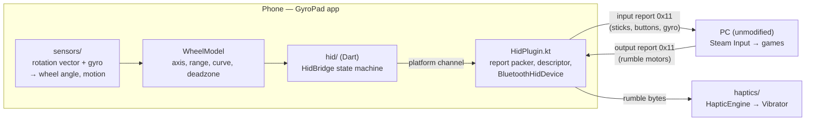
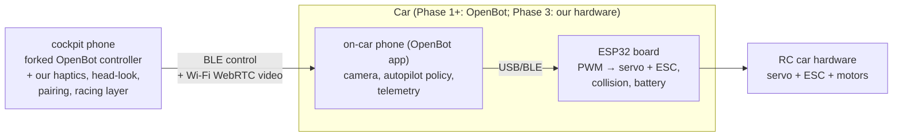

# Architecture

How the system fits together, and the constraints code must respect. This document is the bridge between the decisions ([DECISIONS.md](DECISIONS.md)) and the code: it names the modules, their responsibilities, the contracts between them, and the invariants that must not break.

Read order for implementers: [DECISIONS.md](DECISIONS.md) for why, this file for what and how, [docs/ROADMAP.md](ROADMAP.md) for when, [docs/specs/](specs/README.md) for per-milestone detail. Facts and measurements live in [RESEARCH.md](RESEARCH.md).

## Bird's-eye view

**Tier 1 (Phase 0):** the phone is a DS4 controller; the PC is unmodified.



**Tiers 2–3 (Phase 1+):** the OpenBot pattern — one phone rides the car as camera and brain; the cockpit phone runs our forked controller.



## Tier 1 — the GyroPad app

### Components

| Module | Layer | Responsibility | Key files |
|--------|-------|----------------|-----------|
| `sensors/` (native) | Kotlin | Sensor hot loop (ADR-012): listen gyro + rotation vector at the fastest rate; complementary fusion into the wheel angle; wheel model (range, deadzone, sensitivity, curve, re-zero); publish the fused angle to Dart at ≤60 Hz | `SensorFusion.kt`, `WheelModel.kt` |
| `hid/` (Dart) | Dart | Platform-channel bridge and connection state machine: unpaired → registered → connected → streaming → error; wheel settings + pedal commands to the native owner; wheel-stream republish for the UI | `HidBridge`, `wheel_frame.dart` |
| `hid/` (native) | Kotlin | DS4 emulation: SDP app record, HID report descriptor, the single input-report owner (packing, counter, dedupe, GET_REPORT cache), ~120 Hz sender tick, output-report reception over `BluetoothHidDevice` (API 28+) | `HidPlugin.kt`, `Ds4InputPacker.kt` |
| `haptics/` | Dart→Kotlin | Map rumble bytes to `VibrationEffect` waveforms; rate-limit; degrade gracefully without amplitude control (M3) | `HapticEngine` |
| `layouts/` | Flutter UI | Layout engine rendering declarative layout definitions (ADR-011): wheel layout v1, connection/settings sheets; zero-latency local rendering of input state | `schema.dart`, `layout_engine.dart`, `wheel_layout.dart`, `wheel_screen.dart` |

### The DS4 emulation contract

The emulated controller must behave like a real DS4 or games will misread it. The binding rules (updated 2026-11-11 with the M2 spec — the `0x11` motion path is out, see below):

- **Input report `0x01`** (the small report; the descriptor registered since M1) carries: steering (byte 0, unsigned, center 128 — the fused wheel angle), sticks at center, hat released, the send counter, and pedals (byte 7 = brake/L2, byte 8 = throttle/R2). The byte map lives in the M1/M2 specs and the native packer — never from memory.
- **The `0x11` motion-block path is not used.** A real DS4 switches to report `0x11` when the host reads calibration; on this stack↔Windows pair the full descriptor that declares `0x11` never installed (M1 finding), and the full-descriptor retry experiment was declined by the user (2026-11-08). M2 steering therefore rides the `0x01` axis, which racing games bind natively like any DirectInput wheel. Steam-Input extras (universal gyro, rumble into Steam) need non-disguise routes — decided when M3 nears.
- **Output reports:** rumble (`0x11` over BT) arrives via `onInterruptData`/`onSetReport`; M2 logs it only. Note the small descriptor declares no output report — whether hosts can address rumble at all on this descriptor is part of the M3 decision.
- **Host identity limit:** the phone advertises its own VID/PID; Steam classifies the device **Generic Gamepad** (measured 2026-11-08, final). The M2 wheel needs no Steam blessing.
- **Wheel semantics:** `SensorFusion` (gyro fast path + rotation-vector drift correction, gravity-aware axis) produces the angle; `WheelModel` (re-zero → deadzone → sensitivity → curve → clamp) maps it to the byte.
- **Report rate:** the native sender tick caps at ~120 Hz with latest-state semantics. Never batch or skip frames to save work — stale motion reads as lag.
- **Byte-faithfulness rule:** any change to the descriptor or report packing requires a device test on the user's PC before merge (CONVENTIONS.md).

### Data flows

1. **Input path (hot loop, native — ADR-012):** sensor event (dedicated HandlerThread) → `SensorFusion` → fused angle via a volatile → sender tick on `btExecutor` (≤120 Hz, latest state) → `WheelModel` → `Ds4InputPacker` (dedupe, counter) → `sendReport`. Zero channel crossings and no allocations per event. Budget: end-to-end under ~10 ms on the phone; vibration never runs on this path's thread.
2. **Haptic path (cold loop, M3):** `onOutputReport` → parse motor bytes → `HapticEngine` → `Vibrator` waveform. Rate-limited; drops gracefully on devices without amplitude control.
3. **Wheel UI path:** native tick → ≤60 Hz wheel event stream → Dart `ValueNotifier` → the wheel arc painter (no animation curves; 1-frame reaction budget). Pedals/settings cross the channel Dart→Kotlin at touch/UI rate and merge into the owned report.
4. **Pairing lifecycle:** app registers as HID device on launch → user pairs from the PC's Bluetooth settings (the connection sheet guides with in-app discoverable + bonded-host Connect). Re-zeroing the wheel is a user action, always reachable during play.

### Performance budget

| Quantity | Budget | Why |
|----------|--------|-----|
| Input path (sensor → report sent) | < 10 ms | control feel; measured in M1 |
| Sensor pipeline rate | ≥ 100 Hz target | smooth wheel response at 60 fps display |
| Hot-loop allocations | none | GC pauses read as stutter |
| Local UI reaction to input | 1 frame | trust: the screen confirms the hands |

## Tiers 2–3 — the car stack (direction only)

Phase 1 adopts OpenBot as-is and forks its Flutter controller into our cockpit app. Our additions, in build order:

1. **Haptic mapping** — OpenBot telemetry (collision events, wheel RPM, battery) → the same `HapticEngine` patterns (pillar 1).
2. **Head-look** — cockpit phone gyro pans the FPV view; software pan on a wide-angle stream first, physical gimbal only if Phase 3 hardware justifies it (pillar 2).
3. **Pairing by code** — car advertises; cockpit phone pairs with a printed/QR code; provisioning flow designed at the Phase 2 spec.
4. **Racing layer** — timing, ghosts, leaderboards, built so it bolts onto telemetry without protocol rework (ADR-006).

**Deliberately deferred to their phase specs** (do not implement early): control-link choice for the retrofit board (WebRTC data channel vs BLE), video codec and tuning per board, provisioning/Wi-Fi credential flow, telemetry schema, any cloud component. Naming them here prevents agents from inventing these systems ahead of their specs.

## Invariants

Break any of these and the product degrades in ways users feel:

1. **No PC-side drivers, ever** (ADR-001). The PC path is Bluetooth HID, full stop.
2. **Android-only in Phase 0** (ADR-005). Do not "fix" iOS.
3. **LAN-first video.** 40–100 ms glass-to-glass is the fun zone (RESEARCH); internet racing is a separate later path, never a blocker for local play.
4. **Byte-faithful DS4 emulation.** Descriptor/packing changes require a device test before merge.
5. **Haptics never block control.** The input path and the vibration path are independent threads; losing haptics must never cost a frame of control.
6. **No hot-loop allocations** on the input path (GC pauses read as input stutter).
7. **Single-player first; bolt-on competition.** Telemetry and timing are designed so leaderboards attach later without protocol rework (ADR-006).
8. **Vendored OpenBot code stays licensed and isolated** under `firmware/` (ADR-004).
9. **Specs are the source of truth.** Code implements specs; behavior changes update this document (AGENTS.md contract).

## Where bugs live

| Symptom | First suspect |
|---------|---------------|
| PC doesn't see the gamepad | `HidPlugin.kt` — SDP record, registration, bonding flow |
| Gamepad visible, buttons/sticks dead | report descriptor mismatch, report packing, or `0x11`-vs-`0x01` report mode |
| Steam sees no gyro | VID/PID classification first (host identity limit), then motion region bytes, endianness, timestamp |
| Steering drifts or feels wrong | `sensors/` — fusion, bias, axis choice |
| Rotation range ≠ configured | `WheelModel` mapping and clamping |
| Phone doesn't vibrate from games | `onOutputReport` reception → `HapticEngine` |
| Haptics feel wrong (pattern/timing) | `HapticEngine` waveform mapping |
| UI rotation lags the phone | `layouts/` wheel widget render path (bypasses animation curves) |
| Random disconnects | `HidBridge` state machine, bonding/range handling |

## Source map (planned — keep current as code lands)

```
app/
  lib/
    main.dart
    hid/            HidBridge (lifecycle, commands), wheel_frame.dart
    layouts/        schema.dart, layout_engine.dart, wheel_layout.dart,
                    wheel_screen.dart, sheets, widgets/
  android/
    app/src/main/kotlin/.../HidPlugin.kt        the DS4 emulation core + hot loop
    .../SensorFusion.kt, WheelModel.kt, Ds4InputPacker.kt, Ds4Descriptors.kt
docs/
  specs/          M1-M3 specs (byte maps live here)
```

## How this file evolves

Behavior changes update this document in the same change as the code (AGENTS.md contract). Deferred sections (Tiers 2–3 details) gain content only when their phase spec decides them — new decisions go to [DECISIONS.md](DECISIONS.md) first, then land here.
